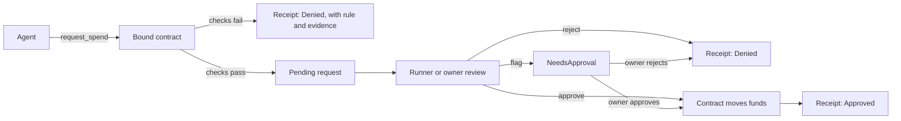

<div align="center">

# SpendGuard

### The spend limit behind your agent. Built on NEAR.

[](LICENSE) [](https://testnet.nearblocks.io/address/bound-testnet-97685.testnet)

[Watch the demo](https://youtu.be/E9JbF9TlKs4) · [Demo post on X](https://x.com/oxunify/status/2120085871852478803) · [Live console](https://spendguard-oxunify.vercel.app/) · [How it works](#how-it-works) · [Verify it yourself](#verify-it-yourself)

</div>

This repository is `near-bound`. The product is SpendGuard. It was built at NEAR HACKATHON, it runs on testnet, and it is not audited.

An AI agent that pays for API or compute credits carries a credential with money behind it. Give it the API key and it has no ceiling. Tell it the limit in a prompt and the instruction competes with every other instruction in the context window. SpendGuard moves the decision out of the agent and into a NEAR contract, so the agent can ask to spend and the chain decides.

## Table of contents

- [The problem I set out to solve](#the-problem-i-set-out-to-solve)
- [What I built](#what-i-built)
- [Demo](#demo)
- [How it works](#how-it-works)
- [On-chain, verified](#on-chain-verified)
- [Verify it yourself](#verify-it-yourself)
- [What's real, what isn't](#whats-real-what-isnt)
- [Engineering decisions](#engineering-decisions)
- [Tech stack](#tech-stack)
- [Project layout](#project-layout)
- [Run it locally](#run-it-locally)
- [Limits](#limits)
- [Licence](#licence)

## The problem I set out to solve

The failure mode is simple. A coding agent reads a dependency README that says an upgrade is required, and it tries to spend the remaining tool budget. The agent is not malicious. It is obedient, and nothing stops it.

The obvious answers all leave the money one instruction away from being lost. An API key in the agent's environment has no ceiling. A vendor rate limit limits a key, not an intention. A prompt is soft, and a poisoned document drowns it.

The money has to live somewhere the agent cannot talk. On NEAR that means a contract, not another prompt.

## What I built

SpendGuard is a NEAR contract that holds the money and the rules for a paid AI agent.

1. I set the rules on chain: a budget per period, a vendor allowlist, a per-spend cap, a rate limit, and a revoke switch.
2. The agent gets a function call access key scoped to one method, `request_spend`, on one contract, with a gas allowance. The key cannot carry a deposit, cannot call another receiver, and cannot afford a call it wasn't budgeted for.
3. When the agent asks, the contract checks the rules at that moment. Break one, and the contract writes a denial receipt with the rule in plain words and the evidence. Pass, and the request waits for a human.
4. The owner approves. The contract moves the funds and writes a receipt. Approved or denied, every decision is a transaction anyone can read.
5. The console at https://spendguard-oxunify.vercel.app reads the receipts from the public testnet RPC. No backend, no database, nothing to trust.

The treasury is inside the contract. The agent's key cannot attach a deposit, and every payment is decided there.

## Demo

<https://youtu.be/E9JbF9TlKs4>

Silent, captions only. It shows the real state: the console, receipt 10 (`BudgetExceeded`), the CLI reads anyone can repeat, and this repository. As of 2026-11-10 the chain shows 12 receipts, 7 of them denials.

The demo post on X, published at NEAR HACKATHON: <https://x.com/oxunify/status/2120085871852478803>

## How it works



The request loop:

1. The agent signs `request_spend` with its scoped key. Only the agent itself may call it for itself.
2. The contract runs the hard checks: kill switch, revoked agent, zero amount, replayed nonce, blocked receiver, vendor allowlist, single spend cap, rate limit, period budget.
3. A failure writes a receipt with the reason, the rule and the evidence. The money does not move.
4. A pass stores the request as Pending. The runner or the owner reviews it. A flagged request escalates to the owner.
5. Approval moves the funds and writes a receipt with `spent_after` and `remaining_after`.

The denial reasons, exactly as the policy engine returns them: `AgentRevoked`, `InvalidAmount`, `NonceReplay`, `CounterpartyBlocked`, `VendorNotAllowed`, `SingleSpendExceeded`, `RateLimited`, `BudgetExceeded`, `KillSwitch`.

Denials are first class. 7 of the 12 receipts on chain at 2026-11-10 are denials. If you want to see the policy refuse something, it is already there.

## On-chain, verified

| Object | Account |
| --- | --- |
| Contract and treasury | `bound-testnet-97685.testnet` |
| Agent | `bound-agent.testnet` |
| Vendor | `bound-vendor.testnet` |
| Receipts at 2026-11-10 | 12 |

Every read in the console can be repeated with two read-only commands. No wallet, no keys.

```bash
near contract call-function as-read-only bound-testnet-97685.testnet \
  get_receipt_count json-args '{}' network-config testnet now

near contract call-function as-read-only bound-testnet-97685.testnet \
  get_receipt json-args '{"receipt_id":10}' network-config testnet now
```

The second command prints `reason: BudgetExceeded` and the rule "the spend would exceed the period budget". Read the live state on nearblocks at https://testnet.nearblocks.io/address/bound-testnet-97685.testnet.

## Verify it yourself

Do X, see Y:

1. Open the nearblocks link above. See the contract deployment and the transactions on chain.
2. Run the two read commands. See `12`, then see receipt 10 with `BudgetExceeded`.
3. Run the policy test suite:

```bash
git clone https://github.com/unifyWeb3/near-bound.git
cd near-bound/policy
cargo test
```

See 17 tests pass. The suite covers the denial paths: over-budget, unknown vendor, single spend cap, rate limit, revoked agent, replayed nonce, zero amount, and the order of the blocklist check.

4. Run the protocol arm against testnet. It needs an owner account and an agent account holding the scoped key.

```bash
demo/protocol_arm.sh <owner> <agent> <vendor> <agent-key-file>
```

See the PASS lines for a method the key cannot call, a receiver the key cannot call, a deposit on a function call key, and a call the key's allowance cannot afford. It writes a denial receipt for the unknown vendor and shows the policy refusing over-budget spends.

## What's real, what isn't

| Claim | State |
| --- | --- |
| Contract, policy engine, receipts | Real, on testnet, live |
| Denial reasons on receipts | Real, written by the contract |
| Figures in the console | Read live from the public testnet RPC at page open |
| Console on RPC failure | Last good view, labelled stale. Never a guessed number |
| Demo video | Animated from real chain state, silent, captions only |
| Counterparty signals | Policy inputs, not live risk feeds |
| Operator side | The NEAR CLI. No browser wallet, no revoke button |
| Audit | Not audited. Testnet only. No real money has moved |

## Engineering decisions

- Gate before spend. The policy runs inside the contract before money moves. A denial is a receipt, not an error string.
- The protocol does the hard enforcement. A function call access key cannot carry a deposit, and it cannot be used outside its receiver and method names. The contract enforces the economic policy. Neither trusts the prompt.
- Denials are first class citizens of the product. They carry the same rule and evidence as approvals.
- The console refuses to lie. If the RPC fails, the page shows the last good view labelled stale instead of a number it cannot defend.
- No backend. The console is a static page that reads the chain. There is no database, no server, and nothing to leak.

## Tech stack

- Contract: Rust, near-sdk. Deployed at `bound-testnet-97685.testnet`.
- Policy engine: pure Rust, dependency-free, unit tested.
- Console: vanilla JavaScript, static page, no build step.
- Operator and demo flows: near-cli-rs on testnet.

## Project layout

```
contract/     Bound contract, deployed on testnet
policy/       Pure policy engine, unit tested
demo/         Protocol arm script and the vendor stand-in
web/          The SpendGuard console, a static page
```

## Run it locally

You need Rust with a C toolchain and, for the CLI reads, near-cli-rs. Then:

```bash
git clone https://github.com/unifyWeb3/near-bound.git
cd near-bound
cd policy && cargo test
```

The console needs no build. Open `web/index.html` in a browser, or visit https://spendguard-oxunify.vercel.app.

## Limits

- Testnet only. No mainnet deployment, no real money has moved.
- Not audited.
- The operator side is the command line, not a website.
- It does not stop the agent from asking. It stops the agent from succeeding outside the policy.
- The counterparty signals are local policy inputs, not live risk feeds.
- The agent's gas comes from its account. The key's allowance caps the gas it can burn.

This is one of two independent NEAR submissions by the same builder, the other is `keyhalt` at https://github.com/unifyWeb3/keyhalt. Built at NEAR HACKATHON.

## Licence

MIT. See LICENSE.
