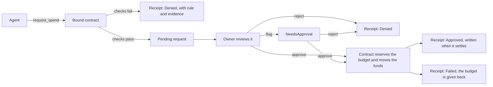

<div align="center">

# SpendGuard

### The spend limit behind your agent. Built on NEAR.

[](LICENSE) [](https://testnet.nearblocks.io/address/bound-testnet-97685.testnet)

[Watch the demo](https://youtu.be/E9JbF9TlKs4) · [Demo post on X](https://x.com/oxunify/status/2120085871852478803) · [Live console](https://near-bound.vercel.app/) · [How it works](#how-it-works) · [Verify it yourself](#verify-it-yourself)

</div>

This repository is `near-bound`. The product is SpendGuard. It was built at NEAR HACKATHON, it runs on testnet, and it is not audited.

The submitted state is the tag `submission-v1`, which points at the commit that
carries this README. The wasm on chain was built from commit
`187fd92843d3a73702e19e95d13a06c36661c8a2`, and the sha256 of that artifact is
the code hash on chain, so the deployed contract is this source and not a
rebuild of it. The sha256 is in [docs/CLAIMS.md](docs/CLAIMS.md).

You can close that loop yourself, with no key and no account:

```bash
curl -s -X POST https://test.rpc.fastnear.com -H 'Content-Type: application/json' \
  -d '{"jsonrpc":"2.0","id":"1","method":"query","params":{"request_type":"view_code","account_id":"bound-testnet-97685.testnet","finality":"final"}}' \
  | jq -r .result.code_base64 | base64 -d | sha256sum
```

```
f720587997a04f8bf9702aeeca3525867b321374e151fe26bfef9ec2ca955a7e  -
```

That is the same number as the code hash on chain, decoded from base58. The
judge evidence below prints the same command for every other figure.

An AI agent that has to pay for API or compute credits carries a credential with money behind it. Give it the API key and it has no ceiling. Tell it the limit in a prompt and the instruction competes with every other instruction in the context window. SpendGuard moves the decision out of the agent and into a NEAR contract, so the agent can ask to spend and the chain decides.

This is a **NEAR Hackathon `security`** entry: spending limits, a policy engine
and a sandboxed wallet, with the scope carried by the access key itself. It is
one of two independent NEAR submissions by the same builder. The other is
`keyhalt` at https://github.com/unifyWeb3/keyhalt, a different product that
shares no code with this one.

## How you use it

Three accounts and a browser. Nothing to install to read it, nothing to sign to
see it.

1. **Read any deployment.** The console reads the chain directly, so it can show
   any SpendGuard contract, not only the demo one. Press the deployment button
   in the header and put in the contract, the agent and the vendor accounts.
   The deployment is in the address bar, so a link to one receipt opens the same
   page on any machine.
2. **Or set one up.** The "Enable it" view has the commands with your own
   account names filled in: three funded testnet accounts, a deploy, a policy,
   a scoped key, the agent's first ask, and the approval that settles it.
3. **Be the owner.** Connect your NEAR wallet and approve or refuse the agent's
   requests in the browser. Every decision becomes a receipt with the rule and
   the figures, and every receipt has a link you can share.

The chain is the database. The console has no backend and asks for no key.

## Table of contents

- [The problem I set out to solve](#the-problem-i-set-out-to-solve)
- [How you use it](#how-you-use-it)
- [What I built](#what-i-built)
- [Demo](#demo)
- [How it works](#how-it-works)
- [On-chain, verified](#on-chain-verified)
- [Verify it yourself](#verify-it-yourself)
- [What's real, what isn't](#whats-real-what-isnt)
- [Known limitations](#known-limitations)
- [Engineering decisions](#engineering-decisions)
- [Tech stack](#tech-stack)
- [Project layout](#project-layout)
- [Run it locally](#run-it-locally)
- [Limits](#limits)
- [Licence](#licence)

## The problem I set out to solve

The failure mode is simple. A coding agent reads a dependency README that says an upgrade is required, and it tries to spend the remaining tool budget. The agent is not malicious. It is obedient, and nothing stops it.

The obvious answers all leave the money one instruction away from being lost. An API key in the agent's environment has no ceiling. A vendor rate limit limits a key, not an intention. A prompt is soft, and a poisoned document drowns it.

The money has to live somewhere the agent cannot talk. On NEAR that means a contract, not another prompt.

## What I built

SpendGuard is a NEAR contract that holds the money and the rules for a paid AI agent.

1. I set the rules on chain: a budget per period, a vendor allowlist, a per-spend cap, a rate limit, and a revoke switch.
2. The agent gets a function call access key scoped to one method, `request_spend`, on one contract, with a gas allowance. The key cannot carry a deposit, cannot call another receiver, and cannot afford a call it wasn't budgeted for.
3. When the agent asks, the contract checks the rules at that moment. Break one, and the contract writes a denial receipt with the rule in plain words and the evidence. Pass, and the request waits for a human.
4. The owner approves. The contract reserves the budget, moves the funds, and writes the receipt when the transfer settles. Approved, denied or failed, every decision is a transaction anyone can read.
5. The console at https://near-bound.vercel.app reads the receipts from the public testnet RPC. No backend, no database, nothing to trust.

The treasury is inside the contract. The agent's key cannot attach a deposit, and every payment is decided there.

### What is claimed, and what enforces it

Every claim below is a rule in the contract, a test that fails without it, and
something on chain to look at. The numbers are in [docs/CLAIMS.md](docs/CLAIMS.md).

| Claim | The rule in the contract | The test | On chain |
| --- | --- | --- | --- |
| The agent cannot move money | The key is a function call key on one method of one contract, so the protocol refuses a deposit and refuses another receiver before the contract runs | `demo/protocol_arm.sh`, all six steps pass | the agent key list, one key, one method, one receiver |
| The policy refuses a spend over the budget | `evaluate` compares the spend so far plus the amount with the budget, and the evidence carries both numbers | `policy`: `a_spend_above_the_remaining_budget_is_denied` | receipt 9 |
| Two approvals cannot go over the budget together | `approve_request` reads the policy again at the moment of approval and reserves the spend before the transfer | `contract`: `two_approvals_cannot_together_go_over_the_budget` | receipt 20 |
| The owner can stop everything with one call | `set_kill_switch`, checked in `request_spend` and in `approve_request` | `contract`: `a_request_made_before_the_freeze_is_refused_after_the_freeze` | the frozen approval was refused and the request stayed open |
| A receipt never says the money moved when it did not | The receipt is written in the settlement callback, after the transfer has run | `contract`: `a_failed_transfer_gives_the_budget_back` | receipt 18 |
| Every decision is readable | Every decision writes a receipt, the refusals too | `policy`: `every_denial_has_a_rule_attached` | [docs/CLAIMS.md](docs/CLAIMS.md) |

## Demo

<https://youtu.be/E9JbF9TlKs4>

Silent, captions only. It shows the real state: the console with a refusal
opened, its rule and its evidence, receipt 18 (the transfer failed and the
budget came back) and receipt 20 (two approvals that could not go over the
budget together), and this repository. The frames are screenshots of the live
console from 2026-11-11 and they name the receipts rather than the counts,
because the counts move every time the demo contract is used. The chain state
and the counts are in [docs/CLAIMS.md](docs/CLAIMS.md).

The demo post on X, published at NEAR HACKATHON: <https://x.com/oxunify/status/2120085871852478803>

## How it works



One party reviews the request. On testnet the owner and the runner are the same
account, `get_owner` and `get_runner` both return
`bound-testnet-97685.testnet`. The contract supports a separate runner account
that the owner names, and a request the runner flags waits for the owner alone.

The request loop:

1. The agent signs `request_spend` with its scoped key. Only the agent itself may call it for itself.
2. The contract runs the hard checks: kill switch, revoked agent, zero amount, replayed nonce, blocked receiver, vendor allowlist, single spend cap, rate limit, period budget.
3. A failure writes a receipt with the reason, the rule and the evidence. The money does not move.
4. A pass stores the request as Pending. The owner reviews it, and a request the owner flags waits for the owner alone.
5. The owner approves. The contract reserves the budget, moves the funds, and writes the receipt when the transfer settles, so a receipt never says the money moved when it did not. A transfer that fails gives the budget back and its receipt says the transfer did not go through.

The owner can freeze every agent with one call. While the freeze is on no request is accepted and no request can be approved, including one the agent asked for before the freeze.

The budget is checked again at the moment the owner approves, not only when the agent asks, so two approvals in the same period cannot go over the budget together.

The denial reasons, exactly as the policy engine returns them: `AgentRevoked`, `InvalidAmount`, `NonceReplay`, `CounterpartyBlocked`, `VendorNotAllowed`, `SingleSpendExceeded`, `RateLimited`, `BudgetExceeded`, `KillSwitch`.

Denials are first class. If you want to see the policy refuse something, it is already there, and [docs/CLAIMS.md](docs/CLAIMS.md) says how many.

## How to read a receipt

A receipt is written once and it is never changed afterwards.

| Outcome | What it means |
| --- | --- |
| `Denied` | The policy refused the request. No money moved and the budget was not touched. |
| `Approved` | The owner approved, the transfer went through and the money moved. |
| `Failed` | The owner approved but the transfer did not go through. The reserved budget was given back and the receipt says why. |

## The state of a request

| Request state | What it means | Receipt | The budget |
| --- | --- | --- | --- |
| `Pending` | The agent asked and the policy passed. The owner can approve or reject it | none yet | untouched |
| `NeedsApproval` | A flag was raised, only the owner can decide it | none yet | untouched |
| `ApprovedPending` | The owner approved. The budget is reserved and the transfer is in flight | none yet, the receipt comes when it settles | reserved |
| `Approved` | The transfer went through | `Approved` | spent |
| `SettlementFailed` | The transfer did not go through | `Failed`, with the reason | given back |
| `Denied` | The policy refused it | `Denied`, with the rule and the evidence | untouched |

While the owner has frozen the agents, `request_spend` refuses with a
`KillSwitch` denial receipt and no request is created, and `approve_request` is
refused outright. A request that is already open stays open and can be
approved once the freeze is lifted.

A request that is `ApprovedPending` has no receipt yet. That is the one state
the console cannot show, because the decision has not been made. The console
shows the number of requests next to the number of receipts, so the gap is
visible, and the gap closes on its own when the transfer settles.

## On-chain, verified

| Object | Account |
| --- | --- |
| Contract and treasury | `bound-testnet-97685.testnet` |
| Agent | `bound-agent.testnet` |
| Counterparty | `bound-vendor.testnet` | the account the contract pays |
| Receipts | the counts are in [docs/CLAIMS.md](docs/CLAIMS.md) |
| Live policy | 5 NEAR an hour, 1 NEAR a payment, 5 payments a minute, one counterparty |

Three receipts show the contract doing the work, and each one is a
transaction anybody can read:

| Receipt | What it shows |
| --- | --- |
| 10 | The policy refused a spend over the period budget, with the figures in the evidence |
| 18 | The owner approved, the transfer to a vendor that does not exist failed, and the reserved budget came back. `outcome` is `Failed` |
| 20 | Two requests of 1 NEAR were made before anything was approved. The first approval took the money and the second was refused, so the two together never went over the budget |

Every read in the console can be repeated with the read-only commands below. No wallet, no keys.

```bash
near contract call-function as-read-only bound-testnet-97685.testnet \
  get_receipt_count json-args '{}' network-config testnet now

near contract call-function as-read-only bound-testnet-97685.testnet \
  get_receipt json-args '{"receipt_id":10}' network-config testnet now
```

The second command prints `reason: BudgetExceeded` and the rule "the spend would exceed the period budget". The console's Judge evidence section has the curl form of these reads and of the two others it needs, the policy and the treasury. Read the live state on nearblocks at https://testnet.nearblocks.io/address/bound-testnet-97685.testnet.

## Verify it yourself

Do X, see Y:

1. Open the nearblocks link above. See the contract deployment and the transactions on chain.
2. Run the two read commands. See the count, then see receipt 10 with `BudgetExceeded`.
3. Run the test suites:

```bash
git clone https://github.com/unifyWeb3/near-bound.git
cd near-bound
make test
```

`make test` runs both suites: `cd policy && cargo test --locked`, then
`cd contract && cargo test --locked`. The two crates are deliberately not a cargo
workspace, because the contract's `Cargo.lock` is what fixes the bytes of the
wasm on chain.

See 17 policy tests pass, then 13 contract tests pass. The policy suite covers the denial paths: over-budget, unknown vendor, single spend cap, rate limit, revoked agent, replayed nonce, zero amount, and the order of the blocklist check. The contract suite covers who may call what, the kill switch stopping an approval, a transfer that settles, a transfer that fails, an agent that cannot be registered twice, and two approvals that cannot together go over the budget.

4. Run the protocol arm against testnet. It needs an owner account, an agent account holding the scoped key, and the key file. The console's "Enable it" view has this command and the ones below with the account names filled in.

```bash
# the scoped key the agent uses
near account add-key bound-agent.testnet grant-function-call-access \
  --allowance 0.2near --contract-account-id bound-testnet-97685.testnet \
  --function-names request_spend autogenerate-new-keypair \
  --signature-scheme ed25519 save-to-legacy-keychain \
  network-config testnet sign-with-legacy-keychain send

demo/protocol_arm.sh bound-testnet-97685.testnet bound-agent.testnet \
  bound-vendor.testnet \
  ~/.near-credentials/testnet/bound-agent.testnet/ed25519_<key>.json
```

See the PASS lines for a method the key cannot call, a receiver the key cannot call, a deposit on a function call key, and a call the key's allowance cannot afford. It writes a denial receipt for the unknown vendor and shows the policy refusing over-budget spends. The output of the run behind the demo is in `demo/protocol_arm.out`.

5. Ask for a spend the way an agent would. The script takes the amount in yoctoNEAR and sends it as base64 encoded JSON, because the CLI turns a JSON number bigger than 2^53 into a float.

```bash
demo/agent.sh --contract bound-testnet-97685.testnet \
  --agent bound-agent.testnet --vendor bound-vendor.testnet \
  --amount 1000000000000000000000000 \
  --key ~/.near-credentials/testnet/bound-agent.testnet/ed25519_<key>.json
```

It prints the transaction, the receipt if the policy wrote one, and a link to
the transaction. It works against any deployment, so a stranger with their own
contract and their own registered agent can run it from a clean clone. The
nonce is not in the command: the script reads the agent's last nonce from the
policy and asks with the next one, because the contract refuses a nonce it has
already seen.

This is a shared demo contract. Every run adds a receipt and spends budget, so
the counts move. The counts are as of the date in [docs/CLAIMS.md](docs/CLAIMS.md).

## Evidence

Every transaction below is on NEAR testnet. The hashes and the figures are
generated by `scripts/claims.py`, so they cannot drift from the chain.

<!-- evidence:start -->
| What | Transaction | Result | Branch |
| --- | --- | --- | --- |
| the contract is upgraded in place, the state carried over | [Bb64yQtpRcu1](https://explorer.testnet.near.org/transactions/Bb64yQtpRcu1yFJyRWeizXZMRJnJY4HBDCWwKxoJw7Ls) | deployed, code hash HdgJrzYbWsQKWgxRvFG1yUD3UM9M89mRGUE7ESTfjE8d, sha256 f720587997a04f8bf9702aeeca3525867b321374e151fe26bfef9ec2ca955a7e | testnet only |
| the agent is given NEAR for gas | [HnHYC226AEEa](https://explorer.testnet.near.org/transactions/HnHYC226AEEaM4L8kuekL86jTp1ur8bnfQEATCpcfsPG) | the agent account can make a call | testnet only |
| the first of two requests for 1 NEAR | [EEHzgVkt4HXT](https://explorer.testnet.near.org/transactions/EEHzgVkt4HXTHCriHq335fpP97Kp6ZQ9M2EmSXfHKjqS) | request 10 | testnet only |
| the second of two requests for 1 NEAR | [GebCsWA4K5S2](https://explorer.testnet.near.org/transactions/GebCsWA4K5S2GHfM1QzmymoQ2p8d1qp6hBsKAcfMsmDb) | request 11 | testnet only |
| the first of the two is approved | [HBD7hJL9bv5N](https://explorer.testnet.near.org/transactions/HBD7hJL9bv5Npir8T9TtNMzJ2DJf4hpbUDWNvQWU6bGW) | receipt 19, Approved | testnet only |
| the second of the two is approved | [6MKVUN9QoLd6](https://explorer.testnet.near.org/transactions/6MKVUN9QoLd6y92nrgrRYfrVWR2DmgCpbRQnnfXb1JEv) | receipt 20, Denied BudgetExceeded | testnet only |
| the agent asks for 0.5 NEAR | [HEBxWQZFBHuJ](https://explorer.testnet.near.org/transactions/HEBxWQZFBHuJNcaZCGcLtaeRJmU8nWVkkgX6sSkhqHPi) | request 8 | testnet only |
| the owner freezes every agent | [GgmPg2rmYi31](https://explorer.testnet.near.org/transactions/GgmPg2rmYi31ZQuDahyhV7PND8a2bfjFQdW6qvUiaWSX) | the kill switch is on | testnet only |
| the owner tries to approve while frozen | [BsoBVYQXyg1N](https://explorer.testnet.near.org/transactions/BsoBVYQXyg1NdvFmURCACBDK6J96PsdSGq8v2bELS8YY) | refused, no receipt, the request stays open | testnet only |
| the owner lifts the freeze | [4dWyQA12DyjU](https://explorer.testnet.near.org/transactions/4dWyQA12DyjUP57XJGocu7iPHYDJpyk9UnTSz4bzwcpD) | the kill switch is off | testnet only |
| the owner approves it | [2jPzCn18sed5](https://explorer.testnet.near.org/transactions/2jPzCn18sed5EXNorsSdbyDcDhkVfEATr7AgHTMiUZ2v) | receipt 17, Approved | testnet only |
| the owner adds a vendor that does not exist | [6HL6VHy1zzoz](https://explorer.testnet.near.org/transactions/6HL6VHy1zzozfDSmLeqmYFcKL1sxWawo6Yvr56CBquA8) | the allowlist has ghost-vendor.testnet | testnet only |
| the agent asks to pay the vendor that does not exist | [Cc6rmKhH5gAa](https://explorer.testnet.near.org/transactions/Cc6rmKhH5gAa89cqARW9zhy2jiFbEGrDnZtm9RmKA9yf) | request 9 | testnet only |
| the owner approves it | [4JTiK48kgmGw](https://explorer.testnet.near.org/transactions/4JTiK48kgmGwLJxjjtdDLEZn7gZhvGVKpqJgT7sXvQRm) | receipt 18, Failed TransferFailed, the budget came back | testnet only |
| the owner removes the vendor that does not exist | [3RgJLNZ5rF4z](https://explorer.testnet.near.org/transactions/3RgJLNZ5rF4zSwcjXzYEKA4NFeJP1ZfahvEsCskonF4S) | the allowlist is back to one vendor | testnet only |

Every row can be checked with the public testnet RPC, with no key and no
explorer. Nearblocks answers a script with a 403, and the public RPC has
no transaction status method, so each line below reads the state the
transaction left behind. Run any of them as it is:

```bash
# the contract is upgraded in place, the state carried over
curl -s -H 'Content-Type: application/json' https://test.rpc.fastnear.com -d '{"jsonrpc":"2.0","id":"1","method":"query","params":{"request_type":"view_account","account_id":"bound-testnet-97685.testnet","finality":"final"}}'

# the agent is given NEAR for gas
curl -s -H 'Content-Type: application/json' https://test.rpc.fastnear.com -d '{"jsonrpc":"2.0","id":"1","method":"query","params":{"request_type":"view_account","account_id":"bound-agent.testnet","finality":"final"}}'

# the first of two requests for 1 NEAR
curl -s -H 'Content-Type: application/json' https://test.rpc.fastnear.com -d '{"jsonrpc":"2.0","id":"1","method":"query","params":{"request_type":"call_function","account_id":"bound-testnet-97685.testnet","method_name":"get_request","args_base64":"eyJyZXF1ZXN0X2lkIjogMTB9","finality":"final"}}'

# the second of two requests for 1 NEAR
curl -s -H 'Content-Type: application/json' https://test.rpc.fastnear.com -d '{"jsonrpc":"2.0","id":"1","method":"query","params":{"request_type":"call_function","account_id":"bound-testnet-97685.testnet","method_name":"get_request","args_base64":"eyJyZXF1ZXN0X2lkIjogMTF9","finality":"final"}}'

# the first of the two is approved
curl -s -H 'Content-Type: application/json' https://test.rpc.fastnear.com -d '{"jsonrpc":"2.0","id":"1","method":"query","params":{"request_type":"call_function","account_id":"bound-testnet-97685.testnet","method_name":"get_receipt","args_base64":"eyJyZWNlaXB0X2lkIjogMTl9","finality":"final"}}'

# the second of the two is approved
curl -s -H 'Content-Type: application/json' https://test.rpc.fastnear.com -d '{"jsonrpc":"2.0","id":"1","method":"query","params":{"request_type":"call_function","account_id":"bound-testnet-97685.testnet","method_name":"get_receipt","args_base64":"eyJyZWNlaXB0X2lkIjogMjB9","finality":"final"}}'

# the agent asks for 0.5 NEAR
curl -s -H 'Content-Type: application/json' https://test.rpc.fastnear.com -d '{"jsonrpc":"2.0","id":"1","method":"query","params":{"request_type":"call_function","account_id":"bound-testnet-97685.testnet","method_name":"get_request","args_base64":"eyJyZXF1ZXN0X2lkIjogOH0=","finality":"final"}}'

# the owner freezes every agent
curl -s -H 'Content-Type: application/json' https://test.rpc.fastnear.com -d '{"jsonrpc":"2.0","id":"1","method":"query","params":{"request_type":"call_function","account_id":"bound-testnet-97685.testnet","method_name":"get_request","args_base64":"eyJyZXF1ZXN0X2lkIjogNn0=","finality":"final"}}'

# the owner tries to approve while frozen
curl -s -H 'Content-Type: application/json' https://test.rpc.fastnear.com -d '{"jsonrpc":"2.0","id":"1","method":"query","params":{"request_type":"call_function","account_id":"bound-testnet-97685.testnet","method_name":"get_request","args_base64":"eyJyZXF1ZXN0X2lkIjogNn0=","finality":"final"}}'

# the owner lifts the freeze
curl -s -H 'Content-Type: application/json' https://test.rpc.fastnear.com -d '{"jsonrpc":"2.0","id":"1","method":"query","params":{"request_type":"call_function","account_id":"bound-testnet-97685.testnet","method_name":"get_kill_switch","args_base64":"e30=","finality":"final"}}'

# the owner approves it
curl -s -H 'Content-Type: application/json' https://test.rpc.fastnear.com -d '{"jsonrpc":"2.0","id":"1","method":"query","params":{"request_type":"call_function","account_id":"bound-testnet-97685.testnet","method_name":"get_receipt","args_base64":"eyJyZWNlaXB0X2lkIjogMTd9","finality":"final"}}'

# the owner adds a vendor that does not exist
curl -s -H 'Content-Type: application/json' https://test.rpc.fastnear.com -d '{"jsonrpc":"2.0","id":"1","method":"query","params":{"request_type":"call_function","account_id":"bound-testnet-97685.testnet","method_name":"get_policy","args_base64":"eyJhZ2VudF9pZCI6ICJib3VuZC1hZ2VudC50ZXN0bmV0In0=","finality":"final"}}'

# the agent asks to pay the vendor that does not exist
curl -s -H 'Content-Type: application/json' https://test.rpc.fastnear.com -d '{"jsonrpc":"2.0","id":"1","method":"query","params":{"request_type":"call_function","account_id":"bound-testnet-97685.testnet","method_name":"get_request","args_base64":"eyJyZXF1ZXN0X2lkIjogOX0=","finality":"final"}}'

# the owner approves it
curl -s -H 'Content-Type: application/json' https://test.rpc.fastnear.com -d '{"jsonrpc":"2.0","id":"1","method":"query","params":{"request_type":"call_function","account_id":"bound-testnet-97685.testnet","method_name":"get_receipt","args_base64":"eyJyZWNlaXB0X2lkIjogMTh9","finality":"final"}}'

# the owner removes the vendor that does not exist
curl -s -H 'Content-Type: application/json' https://test.rpc.fastnear.com -d '{"jsonrpc":"2.0","id":"1","method":"query","params":{"request_type":"call_function","account_id":"bound-testnet-97685.testnet","method_name":"get_policy","args_base64":"eyJhZ2VudF9pZCI6ICJib3VuZC1hZ2VudC50ZXN0bmV0In0=","finality":"final"}}'

```

Every one of these is on testnet. Nothing here has been run on mainnet, and
nothing here can be: there is no mainnet deployment. The branch column says
which. The mainnet branch of this project is not built.
<!-- evidence:end -->

## What's real, what isn't

| Claim | State |
| --- | --- |
| Contract, policy engine, receipts | Real, on testnet, live |
| Denial reasons on receipts | Real, written by the contract |
| The receipt count | Every decision on chain. Eleven of them are tool runs, nine from the agent CLI on 2026-11-10 and 2026-11-11 and two from the protocol arm on 2026-11-06, memoed "stranger", "the agent cli against a stranger" or "probe". The other nineteen are the demo. The counts are in [docs/CLAIMS.md](docs/CLAIMS.md) |
| Figures in the console | Read live from the public testnet RPC at page open |
| The console feed | Every receipt the page read, not a slice of them. The count says "30 of 30" |
| Console on RPC failure | Last good view, labelled stale. Never a guessed number |
| Demo video | Animated from real chain state, silent, captions only |
| What the contract buys | Nothing. It moves NEAR to the counterparty account under the policy. The demo counterparty contract is not on the payment path |
| Counterparty signals | The blocklist and the vendor allowlist the owner sets. No live risk feed, no account age, no code change watch |
| Operator side | The NEAR CLI. No browser wallet, no revoke button |
| Audit | Not audited. Testnet only. No real money has moved |

## Known limitations

Things this does not do, in the open:

- There is no counterparty check service. The owner sets the blocklist and the vendor allowlist, and the policy engine reads them. Nothing scores the receiver itself: not how old the account is, not whether it is a contract or whether its code changed, not how much this agent has paid it before, and no blocklist that other agents can report to. The account age needs an indexer rather than the RPC, and a shared blocklist would change the state layout of a contract that is already live.
- The contract cannot be upgraded in place. It has no migrate method, so a fix needs a redeploy that carries the state over. Two redeploys have been done and both kept every receipt. The one that produced the code on chain is the transaction in the evidence table.
- The receipts are never pruned. Every decision is kept forever, and the contract pays for the storage.
- The runner and the owner are the same account on testnet, so there is no second reviewer yet. The contract supports a separate runner account.
- The contract moves NEAR to the counterparty account. It does not call a metered service, so nothing in a receipt proves the counterparty served anything. The demo contract in `demo/vendor/` shows what a metered call looks like, and it is not on the payment path.
- The NEAR CLI is the operator side, so there is no browser wallet and no revoke button.

## Engineering decisions

- Gate before spend. The policy runs inside the contract before money moves. A denial is a receipt, not an error string.
- The receipt is written when the money moves. The approval reserves the budget and the transfer settles in a callback, so a receipt can never say the money moved when it did not. No receipt is rewritten afterwards.
- The protocol does the hard enforcement. A function call access key cannot carry a deposit, and it cannot be used outside its receiver and method names. The contract enforces the economic policy. Neither trusts the prompt.
- Denials are first class citizens of the product. They carry the same rule and evidence as approvals.
- The console refuses to lie. If the RPC fails, the page shows the last good view labelled stale instead of a number it cannot defend.
- No backend. The console is a static page that reads the chain. There is no database, no server, and nothing to leak.

## Tech stack

- Contract: Rust, near-sdk 5.30.0. Deployed at `bound-testnet-97685.testnet`.
- Policy engine: pure Rust, one dependency (borsh), unit tested.
- Console: vanilla JavaScript, static page, no build step.
- Operator and demo flows: near-cli-rs on testnet.

## Project layout

```
contract/     Bound contract, deployed on testnet, unit tested
policy/       Pure policy engine, unit tested
demo/         Protocol arm script and the demo counterparty
web/          The SpendGuard console, a static page
```

## Run it locally

You need Rust with a C toolchain and, for the CLI reads, near-cli-rs. Then:

```bash
git clone https://github.com/unifyWeb3/near-bound.git
cd near-bound
cd policy && cargo test
cd ../contract && cargo test
```

The console needs no build and no server of its own. It is a static folder, so
serve it with anything, or visit the hosted copy at
https://near-bound.vercel.app.

```bash
cd near-bound/web && python3 -m http.server 8000
# then open http://localhost:8000
```

Opening `web/index.html` straight from the file system does not work: the
browser blocks the module scripts on a `file://` page.

The wasm on testnet was built from commit `187fd92843d3a73702e19e95d13a06c36661c8a2`.
The CI artifact of that commit is the wasm on chain, byte for byte, and the
sha256 of both is in [docs/CLAIMS.md](docs/CLAIMS.md). A later commit that
only changes this README, the demo script or the console does not change the
wasm, so the code hash on chain stays the same.

```bash
export CARGO_HOME=/tmp/bound-cargo
export RUSTFLAGS="--remap-path-prefix=$PWD=repo --remap-path-prefix=$CARGO_HOME/registry/src/index.crates.io-1949cf8c6b5b557f=registry"
cd contract
cargo build --release --locked --target wasm32-unknown-unknown
wasm-opt -Oz --enable-nontrapping-float-to-int --enable-bulk-memory \
  target/wasm32-unknown-unknown/release/bound_contract.wasm -o bound_contract.wasm
```

The cargo home is in that one place on purpose, and the two rewrites take the
machine out of the bytes. The wasm carries the paths of the crates it was
built from, so without them the same source gives different bytes on
different machines.

The sha256 of that wasm and the code hash on chain are in
[docs/CLAIMS.md](docs/CLAIMS.md). They are the same number written two ways,
so a judge can check the deployed code against this source.

## Limits

- Testnet only. No mainnet deployment, no real money has moved.
- Not audited.
- The operator side is the command line, not a website.
- It does not stop the agent from asking. It stops the agent from succeeding outside the policy.
- The counterparty signals are local policy inputs, not live risk feeds.
- The agent's gas comes from its account. The key's allowance caps the gas it can burn, and the allowance belongs to the key: adding NEAR to the agent account does not give the key more gas.
- The vendor allowlist and the blocklist are set by the owner. There is no shared blocklist that other agents can report to yet.
- The contract cannot be upgraded in place. A fix needs a redeploy that carries the state over.
- The NEAR CLI turns a JSON number bigger than 2^53 into a float, so a u128 amount has to go in as `base64-args`. The commands in the console show the form that works.

## A note on the NEAR CLI

The CLI reads `json-args` into a JSON value. An amount of 5 NEAR is
`5000000000000000000000000`, which is bigger than 2^53, so the CLI hands it to
the contract as `5e+24` and the call dies with a trap. `base64-args` carries
the exact bytes:

```bash
near contract call-function as-transaction bound-testnet-97685.testnet set_budget \
  base64-args "$(printf '{"agent_id":"bound-agent.testnet","budget":5000000000000000000000000}' | base64 -w0)" \
  prepaid-gas '100.0 Tgas' attached-deposit '0 NEAR' \
  sign-as bound-testnet-97685.testnet network-config testnet sign-with-legacy-keychain send
```

The CLI also checks the account balance before it sends, while the protocol
charges a function call key's allowance. An agent with only a scoped key still
needs a little NEAR of its own to make a call.

This is one of two independent NEAR submissions by the same builder, the other is `keyhalt` at https://github.com/unifyWeb3/keyhalt, named at the top as well. Built at NEAR HACKATHON.

## Licence

MIT. See LICENSE.
