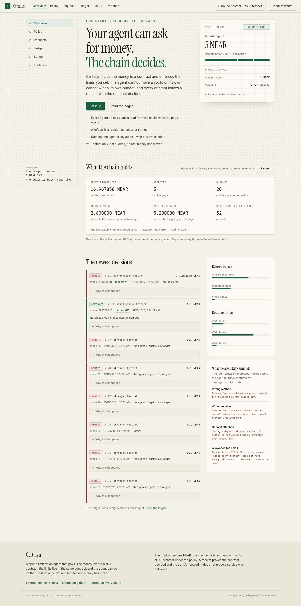

# Certalyn

A spend limit for an agent that pays, enforced by a NEAR contract.

Certalyn holds the money in a contract. The owner sets a budget, a list of
allowed receivers, a cap on one payment, a rate limit and a kill switch. The
agent holds a function call key that can only ask the contract to spend. The
contract decides. Every decision, allowed or refused, is written as a receipt
that anyone can read from the chain.

The role NEAR plays is the enforcement point. A prompt can be argued with, an
API key cannot be capped, and a sandbox is only as strong as the host. A
contract on a shared ledger holds the money and the rules in the same place,
so an agent that cannot change the rules cannot get around them, and a reader
can check what happened without trusting the console.

- Repository: `unifyWeb3/near-bound`
- Console: <https://near-bound.vercel.app/>
- Contract on testnet: `bound-testnet-97685.testnet`
- Licence: MIT

The remediated contract is deployed on testnet. It replaced the older artifact
in place, without an init call, so the receipts and the requests of the
earlier contract were carried over and the owner migrated the state in one
owner call. The Wasm that is on the chain is the one this repository builds,
and its hash is checked by CI and by `docs/claims.json`.

## Try it in five minutes

Testnet NEAR is free. You need the `near` CLI and this repository.

1. Create three funded testnet accounts: one owner and treasury, one agent,
   one counterparty to pay.
2. Deploy the contract and register the agent with a policy.
3. Give the agent a scoped key that can call `request_spend` and nothing else.
4. Ask for a spend as the agent, approve it as the owner, and read the receipt.

The console builds every command for you. Open the **Set up** view, put your
own account names in the three fields, and copy each command as it is
printed. Nothing in this repository needs an account to read, so a judge can
reproduce every figure with the read-only calls in the **Evidence** view.



The console was driven through a real browser at a wide and a narrow width.
The pass, what it found and what it changed are in
[docs/BROWSER-PASS.md](docs/BROWSER-PASS.md).

The demo video is <https://youtu.be/MkUzLlyw50E>. The console is live at
<https://near-bound.vercel.app/> and the contract is live on testnet at
`bound-testnet-97685.testnet`.

## What the agent key can and cannot do

The agent never holds the money and never holds a key that can move it. It
holds a function call access key with four limits, all enforced by the
protocol before the contract runs:

| Limit | Consequence |
| --- | --- |
| one method, `request_spend` | any other call is refused by the protocol |
| one receiver, the contract | the key cannot call a counterparty or itself |
| no deposit allowed | the key cannot attach NEAR to a call |
| a gas allowance | the key cannot afford a call the owner did not budget for |

`demo/protocol_arm.sh` runs those four refusals against the live deployment
and prints the protocol's own error for each one. The output of the recorded
run is in `demo/protocol_arm.out`.

## The contract interface

This table describes the contract that is on the chain.

Arguments are JSON objects, the same shape the NEAR CLI sends with
`json-args`. The console signs the same bytes.

| Method | Who may call it | Arguments | What it does |
| --- | --- | --- | --- |
| `request_spend` | the agent, for itself | `agent_id, vendor, amount, nonce, memo` | runs the hard checks, then waits for the owner |
| `approve_request` | owner or runner for `Pending`; owner for `NeedsApproval` | `request_id` | reserves the budget and moves the money |
| `owner_approve_request` | owner | `request_id` | approves a request that was flagged for a human |
| `flag_request` | owner or runner | `request_id, reasons` | sends a request to the owner |
| `reject_request` | owner or runner for `Pending`; owner for `NeedsApproval` | `request_id, reason` | refuses a request and writes the receipt |
| `owner_reject_request` | owner | `request_id, reason` | refuses a flagged request |
| `expire_request` | owner or runner | `request_id, reason` | closes an open request, nothing moves |
| `reconcile_request` | owner | `request_id, moved` | settles a request whose callback never arrived |
| `set_budget`, `set_max_single_spend`, `set_rate_limit`, `set_vendors` | owner | `agent_id, ...` | change the limits, the counters stay |
| `set_revoked` | owner | `agent_id, revoked` | locks one agent out |
| `set_kill_switch` | owner | `on` | freezes every agent |
| `block_account`, `unblock_account` | owner | `account_id` | refuses one receiver |
| `register_agent` | owner | `agent_id, budget, period_seconds, vendors, max_single_spend, rate_limit` | creates one policy |
| `migrate` | owner | none | indexes the history written before the upgrade |

Views: `get_policy`, `get_request`, `get_request_view`, `get_requests`,
`get_open_requests`, `get_receipt`, `get_receipt_safe`, `get_agent_receipts`,
`get_agent_receipt_count`, `get_receipt_count`, `get_request_ids`,
`get_kill_switch`, `get_owner`, `get_runner`, `treasury_balance`.

## The rules and the order they run in

The rules live in the `bound-policy` crate as a pure function, so they can be
tested without a chain. The order is part of the design. A dangerous receiver
is refused before the budget is looked at, so a bad receiver is refused even
when money is left.

1. `AgentRevoked`, the owner locked this agent out
2. `InvalidAmount`, the amount is zero
3. `NonceReplay`, the nonce was already used by this agent
4. `CounterpartyBlocked`, the receiver is on the blocklist
5. `VendorNotAllowed`, the receiver is not on the allowlist
6. `SingleSpendExceeded`, the amount is above the cap
7. `RateLimited`, too many payments in the last minute
8. `BudgetExceeded`, the spend would pass the period budget
9. `KillSwitch`, the owner froze every agent

A denial is a receipt, not an error string. It carries the rule in plain
words and the facts behind it.

## How a payment settles

The budget is reserved at approval, not at settlement, so two approvals in the
same period cannot together go over the budget. The receipt is written in the
settlement callback, after the transfer has run, so a receipt never claims
the money moved when it did not.

| State | Receipt | The budget |
| --- | --- | --- |
| `Pending` | none yet | untouched |
| `NeedsApproval` | none yet | untouched |
| `ApprovedPending` | none yet, it comes when the transfer settles | reserved |
| `Approved` | `Approved` | spent |
| `SettlementFailed` | `Failed`, with the reason | given back |
| `Denied` | `Denied`, with the rule and the evidence | untouched |
| `Expired` | `Expired` | untouched |

A failed payment gives the budget back and refunds the rate slot only if the
failure settles in the window that reserved it. The settlement receipt reports
settled money and reserved money separately. The settlement accounting is
constant time, so the callback cannot run out of gas as the ledger grows. If a
callback still never arrives, the owner closes the request with
`reconcile_request`, and the reservation is settled by hand.

## Evidence

Every chain-derived figure in this repository comes from a script that reads
the live deployment. Source constants and test counts are labelled as such.

```bash
python3 scripts/claims.py          # write docs/CLAIMS.md and docs/claims.json
python3 scripts/claims.py --check  # fail when the live deployment differs
```

The generated tables are in [docs/CLAIMS.md](docs/CLAIMS.md). The read-only
curl for every figure is in the console's **Evidence** view, and the
transactions behind the recorded run are in the evidence table of this
repository.

<!-- evidence:start -->
| What | Transaction | Result | Branch |
| --- | --- | --- | --- |
| the contract is upgraded in place, the state carried over | [Bb64yQtpRcu1](https://explorer.testnet.near.org/transactions/Bb64yQtpRcu1yFJyRWeizXZMRJnJY4HBDCWwKxoJw7Ls) | deployed, code hash 2y4qWBRoomLCA3prgdUrneAhUP4ub6mLPLbtkmmMgApW, sha256 1d388cc6c47a8e3dc566c56dc37541f35e7442fe2642b0961be7d7a4d477635f | testnet only |
| the agent is given NEAR for gas | [HnHYC226AEEa](https://explorer.testnet.near.org/transactions/HnHYC226AEEaM4L8kuekL86jTp1ur8bnfQEATCpcfsPG) | the agent account can make a call | testnet only |
| the first of two requests for 1 NEAR | [EEHzgVkt4HXT](https://explorer.testnet.near.org/transactions/EEHzgVkt4HXTHCriHq335fpP97Kp6ZQ9M2EmSXfHKjqS) | request 10 | testnet only |
| the second of two requests for 1 NEAR | [GebCsWA4K5S2](https://explorer.testnet.near.org/transactions/GebCsWA4K5S2GHfM1QzmymoQ2p8d1qp6hBsKAcfMsmDb) | request 11 | testnet only |
| the first of the two is approved | [HBD7hJL9bv5N](https://explorer.testnet.near.org/transactions/HBD7hJL9bv5Npir8T9TtNMzJ2DJf4hpbUDWNvQWU6bGW) | receipt 19, Approved | testnet only |
| the second of the two is approved | [6MKVUN9QoLd6](https://explorer.testnet.near.org/transactions/6MKVUN9QoLd6y92nrgrRYfrVWR2DmgCpbRQnnfXb1JEv) | receipt 20, Denied BudgetExceeded | testnet only |
| the agent asks for 0.5 NEAR | [HEBxWQZFBHuJ](https://explorer.testnet.near.org/transactions/HEBxWQZFBHuJNcaZCGcLtaeRJmU8nWVkkgX6sSkhqHPi) | request 8 | testnet only |
| the owner freezes every agent | [GgmPg2rmYi31](https://explorer.testnet.near.org/transactions/GgmPg2rmYi31ZQuDahyhV7PND8a2bfjFQdW6qvUiaWSX) | the kill switch is on | testnet only |
| the owner tries to approve while frozen | [BsoBVYQXyg1N](https://explorer.testnet.near.org/transactions/BsoBVYQXyg1NdvFmURCACBDK6J96PsdSGq8v2bELS8YY) | refused, no receipt, the request stays open | testnet only |
| the owner lifts the freeze | [4dWyQA12DyjU](https://explorer.testnet.near.org/transactions/4dWyQA12DyjUP57XJGocu7iPHYDJpyk9UnTSz4bzwcpD) | the kill switch is off | testnet only |
| the owner approves it | [2jPzCn18sed5](https://explorer.testnet.near.org/transactions/2jPzCn18sed5EXNorsSdbyDcDhkVfEATr7AgHTMiUZ2v) | receipt 17, Approved | testnet only |
| the owner adds a vendor that does not exist | [6HL6VHy1zzoz](https://explorer.testnet.near.org/transactions/6HL6VHy1zzozfDSmLeqmYFcKL1sxWawo6Yvr56CBquA8) | the allowlist has ghost-vendor.testnet | testnet only |
| the agent asks to pay the vendor that does not exist | [Cc6rmKhH5gAa](https://explorer.testnet.near.org/transactions/Cc6rmKhH5gAa89cqARW9zhy2jiFbEGrDnZtm9RmKA9yf) | request 9 | testnet only |
| the owner approves it | [4JTiK48kgmGw](https://explorer.testnet.near.org/transactions/4JTiK48kgmGwLJxjjtdDLEZn7gZhvGVKpqJgT7sXvQRm) | receipt 18, Failed TransferFailed, the budget came back | testnet only |
| the owner removes the vendor that does not exist | [3RgJLNZ5rF4z](https://explorer.testnet.near.org/transactions/3RgJLNZ5rF4zSwcjXzYEKA4NFeJP1ZfahvEsCskonF4S) | the allowlist is back to one vendor | testnet only |
| the remediated contract is deployed in place, the state carried over | [74PGYcLQ3drC](https://explorer.testnet.near.org/transactions/74PGYcLQ3drCFUzFAju48nfECM7CddWpRVTiX7Xrikfs) | deployed, code hash 2y4qWBRoomLCA3prgdUrneAhUP4ub6mLPLbtkmmMgApW, sha256 1d388cc6c47a8e3dc566c56dc37541f35e7442fe2642b0961be7d7a4d477635f | testnet only |
| the legacy state is migrated in place | no transaction, the state is the evidence | the migration is complete, the request index holds 15 ids including the request the historical index had lost, and no historical record waits for the owner | testnet only |
| the agent asks for 0.1 NEAR with the remediated contract | [4FoF36c7kaoa](https://explorer.testnet.near.org/transactions/4FoF36c7kaoaTRFmjJpd5HSP8iP4rVG7tX6WWN6v5EyK) | request 15, the nonce is above every nonce the historical contract accepted | testnet only |
| the owner approves it and the transfer settles | [6FdubrFpDKXP](https://explorer.testnet.near.org/transactions/6FdubrFpDKXPbaN5mPMiD51LfM11kuP9skDmhNEPgx7R) | receipt 30, Approved, the receipt reports the settled and the reserved money apart | testnet only |
| the settlement fix is deployed in place, the migrated state carried over | [EyX8weDu2yi5](https://explorer.testnet.near.org/transactions/EyX8weDu2yi5o5vzwaDHhA2JBkGzEE5ffNSPAkjaERxx) | deployed, code hash 2y4qWBRoomLCA3prgdUrneAhUP4ub6mLPLbtkmmMgApW, sha256 1d388cc6c47a8e3dc566c56dc37541f35e7442fe2642b0961be7d7a4d477635f | testnet only |
| the owner approves a historical request and the nonce discipline refuses it | [7Y2CosYUCokf](https://explorer.testnet.near.org/transactions/7Y2CosYUCokfuxp3WZDCVjzKqU828QFHWqv5CwcnKCmR) | receipt 31, Denied NonceReplay, the nonce of the old request is below every nonce the agent had approved | testnet only |

Every row can be checked with the public testnet RPC, with no key and no
explorer. Nearblocks answers a script with a 403, and the public RPC has
no transaction status method, so each line below reads the state the
transaction left behind. Run any of them as it is:

```bash
# the contract is upgraded in place, the state carried over
curl -s -H 'Content-Type: application/json' https://test.rpc.fastnear.com -d '{"jsonrpc":"2.0","id":"1","method":"query","params":{"request_type":"view_account","account_id":"bound-testnet-97685.testnet","finality":"final"}}'

# the agent is given NEAR for gas
curl -s -H 'Content-Type: application/json' https://test.rpc.fastnear.com -d '{"jsonrpc":"2.0","id":"1","method":"query","params":{"request_type":"view_account","account_id":"bound-agent.testnet","finality":"final"}}'

# the first of two requests for 1 NEAR
curl -s -H 'Content-Type: application/json' https://test.rpc.fastnear.com -d '{"jsonrpc":"2.0","id":"1","method":"query","params":{"request_type":"call_function","account_id":"bound-testnet-97685.testnet","method_name":"get_request","args_base64":"eyJyZXF1ZXN0X2lkIjogMTB9","finality":"final"}}'

# the second of two requests for 1 NEAR
curl -s -H 'Content-Type: application/json' https://test.rpc.fastnear.com -d '{"jsonrpc":"2.0","id":"1","method":"query","params":{"request_type":"call_function","account_id":"bound-testnet-97685.testnet","method_name":"get_request","args_base64":"eyJyZXF1ZXN0X2lkIjogMTF9","finality":"final"}}'

# the first of the two is approved
curl -s -H 'Content-Type: application/json' https://test.rpc.fastnear.com -d '{"jsonrpc":"2.0","id":"1","method":"query","params":{"request_type":"call_function","account_id":"bound-testnet-97685.testnet","method_name":"get_receipt","args_base64":"eyJyZWNlaXB0X2lkIjogMTl9","finality":"final"}}'

# the second of the two is approved
curl -s -H 'Content-Type: application/json' https://test.rpc.fastnear.com -d '{"jsonrpc":"2.0","id":"1","method":"query","params":{"request_type":"call_function","account_id":"bound-testnet-97685.testnet","method_name":"get_receipt","args_base64":"eyJyZWNlaXB0X2lkIjogMjB9","finality":"final"}}'

# the agent asks for 0.5 NEAR
curl -s -H 'Content-Type: application/json' https://test.rpc.fastnear.com -d '{"jsonrpc":"2.0","id":"1","method":"query","params":{"request_type":"call_function","account_id":"bound-testnet-97685.testnet","method_name":"get_request","args_base64":"eyJyZXF1ZXN0X2lkIjogOH0=","finality":"final"}}'

# the owner freezes every agent
curl -s -H 'Content-Type: application/json' https://test.rpc.fastnear.com -d '{"jsonrpc":"2.0","id":"1","method":"query","params":{"request_type":"call_function","account_id":"bound-testnet-97685.testnet","method_name":"get_request","args_base64":"eyJyZXF1ZXN0X2lkIjogNn0=","finality":"final"}}'

# the owner tries to approve while frozen
curl -s -H 'Content-Type: application/json' https://test.rpc.fastnear.com -d '{"jsonrpc":"2.0","id":"1","method":"query","params":{"request_type":"call_function","account_id":"bound-testnet-97685.testnet","method_name":"get_request","args_base64":"eyJyZXF1ZXN0X2lkIjogNn0=","finality":"final"}}'

# the owner lifts the freeze
curl -s -H 'Content-Type: application/json' https://test.rpc.fastnear.com -d '{"jsonrpc":"2.0","id":"1","method":"query","params":{"request_type":"call_function","account_id":"bound-testnet-97685.testnet","method_name":"get_kill_switch","args_base64":"e30=","finality":"final"}}'

# the owner approves it
curl -s -H 'Content-Type: application/json' https://test.rpc.fastnear.com -d '{"jsonrpc":"2.0","id":"1","method":"query","params":{"request_type":"call_function","account_id":"bound-testnet-97685.testnet","method_name":"get_receipt","args_base64":"eyJyZWNlaXB0X2lkIjogMTd9","finality":"final"}}'

# the owner adds a vendor that does not exist
curl -s -H 'Content-Type: application/json' https://test.rpc.fastnear.com -d '{"jsonrpc":"2.0","id":"1","method":"query","params":{"request_type":"call_function","account_id":"bound-testnet-97685.testnet","method_name":"get_policy","args_base64":"eyJhZ2VudF9pZCI6ICJib3VuZC1hZ2VudC50ZXN0bmV0In0=","finality":"final"}}'

# the agent asks to pay the vendor that does not exist
curl -s -H 'Content-Type: application/json' https://test.rpc.fastnear.com -d '{"jsonrpc":"2.0","id":"1","method":"query","params":{"request_type":"call_function","account_id":"bound-testnet-97685.testnet","method_name":"get_request","args_base64":"eyJyZXF1ZXN0X2lkIjogOX0=","finality":"final"}}'

# the owner approves it
curl -s -H 'Content-Type: application/json' https://test.rpc.fastnear.com -d '{"jsonrpc":"2.0","id":"1","method":"query","params":{"request_type":"call_function","account_id":"bound-testnet-97685.testnet","method_name":"get_receipt","args_base64":"eyJyZWNlaXB0X2lkIjogMTh9","finality":"final"}}'

# the owner removes the vendor that does not exist
curl -s -H 'Content-Type: application/json' https://test.rpc.fastnear.com -d '{"jsonrpc":"2.0","id":"1","method":"query","params":{"request_type":"call_function","account_id":"bound-testnet-97685.testnet","method_name":"get_policy","args_base64":"eyJhZ2VudF9pZCI6ICJib3VuZC1hZ2VudC50ZXN0bmV0In0=","finality":"final"}}'

# the remediated contract is deployed in place, the state carried over
curl -s -H 'Content-Type: application/json' https://test.rpc.fastnear.com -d '{"jsonrpc":"2.0","id":"1","method":"query","params":{"request_type":"view_account","account_id":"bound-testnet-97685.testnet","finality":"final"}}'

# the legacy state is migrated in place
curl -s -H 'Content-Type: application/json' https://test.rpc.fastnear.com -d '{"jsonrpc":"2.0","id":"1","method":"query","params":{"request_type":"call_function","account_id":"bound-testnet-97685.testnet","method_name":"get_migration_status","args_base64":"e30=","finality":"final"}}'

# the agent asks for 0.1 NEAR with the remediated contract
curl -s -H 'Content-Type: application/json' https://test.rpc.fastnear.com -d '{"jsonrpc":"2.0","id":"1","method":"query","params":{"request_type":"call_function","account_id":"bound-testnet-97685.testnet","method_name":"get_request","args_base64":"eyJyZXF1ZXN0X2lkIjogMTV9","finality":"final"}}'

# the owner approves it and the transfer settles
curl -s -H 'Content-Type: application/json' https://test.rpc.fastnear.com -d '{"jsonrpc":"2.0","id":"1","method":"query","params":{"request_type":"call_function","account_id":"bound-testnet-97685.testnet","method_name":"get_receipt","args_base64":"eyJyZWNlaXB0X2lkIjogMzB9","finality":"final"}}'

# the settlement fix is deployed in place, the migrated state carried over
curl -s -H 'Content-Type: application/json' https://test.rpc.fastnear.com -d '{"jsonrpc":"2.0","id":"1","method":"query","params":{"request_type":"view_account","account_id":"bound-testnet-97685.testnet","finality":"final"}}'

# the owner approves a historical request and the nonce discipline refuses it
curl -s -H 'Content-Type: application/json' https://test.rpc.fastnear.com -d '{"jsonrpc":"2.0","id":"1","method":"query","params":{"request_type":"call_function","account_id":"bound-testnet-97685.testnet","method_name":"get_receipt","args_base64":"eyJyZWNlaXB0X2lkIjogMzF9","finality":"final"}}'

```

Every one of these is on testnet. Nothing here has been run on mainnet, and
nothing here can be: there is no mainnet deployment. The branch column says
which. The mainnet branch of this project is not built.
<!-- evidence:end -->

The wasm is built reproducibly. The build script compiles twice in separate
directories, compares the bytes, and writes a manifest. The expected hash is
committed in [docs/wasm-lock.json](docs/wasm-lock.json) and CI fails when the
build produces different bytes.

```bash
bash scripts/build-wasm.sh
```

## What is real and what is not

| Claim | State |
| --- | --- |
| The contract and its receipts | Real, on testnet, and live |
| The remediated contract source | The source of the live artifact. The Wasm on the chain is the one this repository builds |
| The refusal reasons on the older receipts | Real, written by the older artifact, and kept byte for byte |
| The console figures | Read from the selected deployment when the page opens |
| The console on a failed read | The last good read, marked stale. Never a guessed number |
| What the contract buys | Nothing. It moves NEAR to the counterparty account with a plain transfer under the policy |
| Counterparty signals | The blocklist and the allowlist the owner sets. No risk feed, no account age, no code change watch |
| The browser writes | Approve and refuse, signed by the reader's own wallet |
| A historical request with an old nonce | It cannot be approved, because a nonce has to be above every nonce the agent had approved. The owner closes it and the agent asks again |
| Audit | No independent security audit. Internal remediation and regression tests only. Testnet only. No real money has moved |

A receipt proves the contract decided and the transfer settled. It does not
prove a service was delivered.

## What this branch changed

The audit of the previous revision found broken approval and console-write
flows, settlement and nonce defects, and state-growth risks. They are fixed
here, with tests.

| Finding | Fix | Test |
| --- | --- | --- |
| A flagged request could never be approved, because the owner path delegated to a method that only accepts `Pending` | `approve_request` accepts an open request, and a flagged one needs the owner | `the_owner_can_approve_a_flagged_request`, `the_runner_cannot_approve_a_flagged_request` |
| The console sent Borsh arguments to a contract that reads JSON, so no browser write could succeed | The arguments are a JSON object, signed as bytes | `wallet arguments are JSON argument objects, not Borsh arrays` |
| The settlement callback walked the whole request history, so it could run out of gas and leave the budget reserved with no way out | The reservation is held in a sidecar keyed by agent and period, and the owner can reconcile a request that never settled | `the_settlement_is_constant_time_with_a_long_history`, `the_owner_can_reconcile_a_request_that_never_settled` |
| A failed payment kept its rate slot | The slot comes back only in the approval window that reserved it | `a_failed_payment_gives_the_rate_slot_back`, `an_old_rate_window_failure_does_not_refund_a_new_window` |
| A nonce could be replayed while the first request was still undecided | Accepted and approved nonce watermarks are tracked separately per agent | `an_accepted_nonce_cannot_be_replayed`, `approvals_use_a_separate_monotonic_nonce_watermark` |
| Legacy state could be used without building the new indexes | A fresh state writes a schema marker; legacy state requires an owner-only, bounded, resumable migration | `the_migration_marks_the_schema_and_keeps_the_requests`, `the_legacy_migration_is_batched_and_resumable`, `the_migration_finishes_on_the_shape_of_the_live_contract` |
| Receipt history and per-agent pages could grow without a bound | The contract retains 10,000 receipts, keeps a 256-entry request index, and pages through versioned receipt indexes | `the_legacy_migration_enforces_the_receipt_retention_limit`, `the_request_index_is_bounded_to_256_ids` |
| Settlement totals could count a reservation as money moved | Settled and reserved totals are separate, and settlement records the exact reservation period | `a_failed_reservation_is_reported_separately_from_settled_money`, `payments_that_settle_out_of_order_leave_the_right_figures` |
| The console read the whole ledger of every agent to show one agent | The contract reads one agent's receipts in pages | `getLedger on a paged contract uses the agent page view` |
| The receipt cache could serve receipts from a state that no longer exists | Cached receipts the chain cannot have any more are dropped | `the cache drops receipts the chain cannot have` |
| The big number parser could corrupt a receipt whose memo held a long number | Numbers outside strings are quoted, strings are left alone | `parseBigJson does not touch a long number inside a string` |

The full table, with the checks that cover each line, is in
[docs/AUDIT-REMEDIATION.md](docs/AUDIT-REMEDIATION.md).

The live deployment carries the artifact this source builds. Its hash is in
[docs/CLAIMS.md](docs/CLAIMS.md), and the expected hash of the artifact is in
[docs/wasm-lock.json](docs/wasm-lock.json). CI fails when the build produces
different bytes, and the deployed code hash was read back from the chain after
the deployment.

## Run it locally

```bash
make test          # Rust, fake-NEAR, dependency-gate and console tests
make test-shell    # the demo scripts against a fake near CLI
cd web && npm test # the console unit tests
make fmt           # rustfmt
make clippy        # clippy with warnings denied
make verify-local  # build the wasm twice and compare the bytes
```

The console is a static folder with no build step. Serve it over HTTP, the
browser blocks module scripts on a `file://` page.

```bash
cd web && python3 -m http.server 8000
```

## Repository layout

```
contract/     the contract on chain, unit tested
policy/       the policy engine as a pure function, unit tested
web/          the console, a static page with no backend
demo/         the protocol arm, the agent script, the counterparty contract
scripts/      the claims generator and the reproducible wasm build
tests/        the shell tests against a fake near CLI
docs/         the generated claims, the decisions, the audit table
```

## Limits

- Testnet only. No mainnet deployment, no real money has moved.
- No independent security audit.
- The remediated source retains at most 10,000 receipts. Older receipts are
  pruned, so the chain is not a permanent archive.
- A contract change still needs a redeploy. The remediated source preserves
  the frozen state layout and uses versioned sidecars; `migrate` builds those
  indexes in bounded batches before request operations resume.
- The counterparty signals are local policy inputs, not live risk feeds.
- The agent's gas comes from its account. The key's allowance caps the gas it
  can burn, and adding NEAR to the agent account does not raise the
  allowance.

## Licence

MIT. See [LICENSE](LICENSE).
