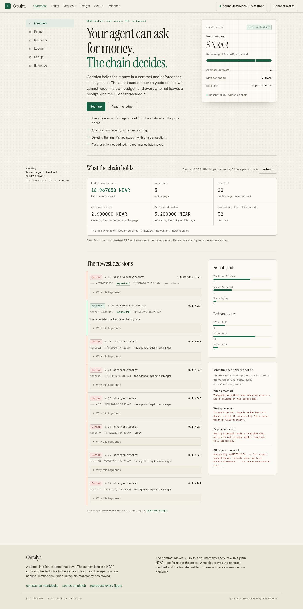
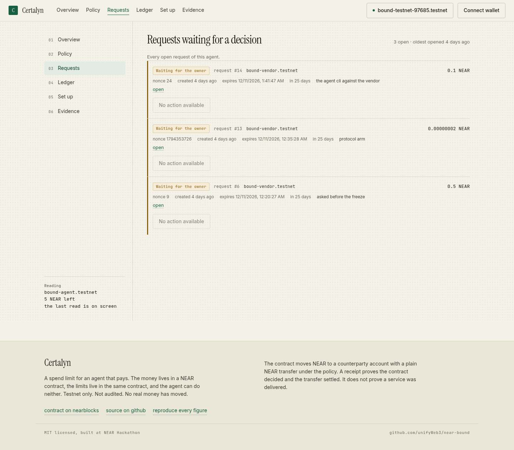
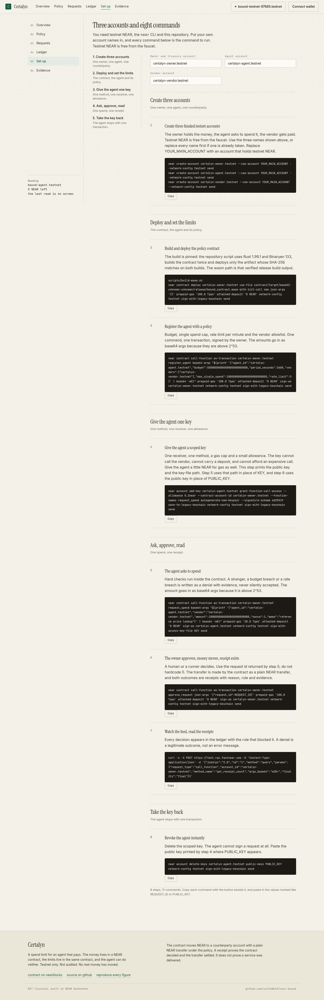
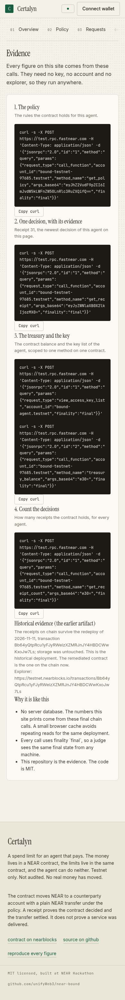

# The browser pass

The console is a static page that reads the chain from the browser. Unit
tests cannot tell whether it lays out, whether the focus ring is visible, or
whether the page scrolls sideways on a phone. This is the pass that answers
those questions in a real browser, what it found, and what was changed.

## The environment

| Item | Value |
| --- | --- |
| Browser | Google Chrome for Testing 158.0.8127.18, headless, from the Playwright cache |
| Driver | `playwright-core` 1.55.0, installed outside the repository |
| Viewports | 1440 x 900 and 390 x 844 |
| Chain | the live testnet deployment, read through the public RPC at finality `final` |
| Date | 2026-11-15 |

The console itself has no browser dependency. The harness lives in
`tests/browser/pass.js` and needs a Chromium and `playwright-core`, which
are not part of the product:

```bash
mkdir -p /tmp/certalyn-browser && cd /tmp/certalyn-browser
npm init -y && npm install playwright-core
npx playwright install chromium

cd /path/to/near-bound
PASS_OUT=/tmp/certalyn-browser/out \
NODE_PATH=/tmp/certalyn-browser/node_modules \
node tests/browser/pass.js
```

The pass serves the console from `web/` on a local port, drives it, writes a
screenshot of every route at both widths, walks the keyboard, checks the
reduced motion preference, and records every console error, page error and
failed request. It exits non-zero when a route scrolls sideways, when the
browser reports an error, or when a focus stop has no visible ring.

## What it found

| # | Finding | Severity | Fix | Check |
|---|---------|----------|-----|-------|
| 1 | The Evidence view pushed the page sideways on a phone. The explorer link is one long word with no break in it, so the page was 661 pixels wide in a 390 pixel viewport | High | The prose in the console may break a long word, and the historical explorer link is written as a link that wraps | The narrow pass reports no overflow on any route |
| 2 | The section navigation pushed the page sideways on a phone. A grid item will not shrink below its content unless it is told to, so the navigation was 633 pixels wide in a 390 pixel viewport | High | The navigation is the scroller on a narrow screen, and the edge fades so the reader can see that it scrolls | The narrow pass reports no overflow on any route |
| 3 | The top bar was taller than its content on a phone. The deployment name wrapped over three lines and the wallet button over two | Medium | The bar height is one token, the deployment name is cut with an ellipsis, the wallet button shortens, and the brand word stays | The narrow pass reports no overflow on any route |
| 4 | The headline broke after "for", leaving "money." alone on a line | Low | The last two words of the headline cannot be separated | The wide pass shows two balanced lines |
| 5 | The Evidence view still called the live deployment the historical one, after the remediated contract replaced it | Low | The heading names the earlier artifact and the text says which contract is on the chain | The wide pass of the Evidence view |

## The de-slop pass

The console was then read against the checklist in
[heydamir/unslop](https://github.com/heydamir/unslop), which is licensed
under CC BY 4.0, and against two more pages that were not read in the first
pass: [agentpassport.ai](https://agentpassport.ai) and
[metriclp.xyz](https://metriclp.xyz).

What the two pages taught:

- agentpassport.ai names its steps after what the reader has done when the
  step is over: "01 Install with one line", "02 Set your limits", "03 Ask for
  a job". The setup phases now read "Create three accounts", "Deploy and set
  the limits", "Give the agent one key", "Ask, approve, read" and "Take the
  key back".
- metriclp.xyz states the honest qualifier in its first paragraph, before
  anything else: independent, unofficial, read only. The README now carries
  "Testnet only, not audited, and no real money has moved" in its opening
  line rather than in a table further down.

What the checklist found in the console, and what changed:

| Finding | Severity | Fix | Check |
| --- | --- | --- | --- |
| Eight labels were set in capitals with wide tracking, the tell of a screen nobody decided | High | Every label is sentence case in the same mono family, the way a printed record sets a column head | The browser pass screenshots |
| Seven sizes carried negative letter spacing, including the 19 and 20 pixel headings | Medium | Tight tracking is left on the two display sizes and the large figure, and nowhere else | The browser pass renders the page |
| The screen had two easing curves | Low | One curve across the screen | `one easing curve, and it is used everywhere` |
| The mark beside the deployment name breathed, which claims a live connection the console does not have | High | The mark is still. The console reads the chain when it opens and when it is refreshed, and it prints the time of the read | `nothing loops on a loaded page, because the console is not a live feed` |
| Six figures sat in six equal boxes, which reads as a template | Medium | The one figure that matters, the money the contract holds, carries the accent and the rest stay quiet numbers in a printed table | The overview screenshot |
| The sidebar said the chain was being read live | High | It says the last read is on screen | The overview screenshot |

The slop scan over the prose is explicit and empty: no em dash or en dash, no
exclamation mark outside a comment, no hype word from the list the checklist
names, no emoji in the interface, and no placeholder text in the README or
the docs.

## The results after the fix

| Route | 1440 x 900 | 390 x 844 | Console errors |
| --- | --- | --- | --- |
| Overview | no overflow | no overflow | none |
| Policy | no overflow | no overflow | none |
| Requests | no overflow | no overflow | none |
| Ledger | no overflow | no overflow | none |
| Enable | no overflow | no overflow | none |
| Evidence | no overflow | no overflow | none |

| Check | Result |
| --- | --- |
| Console errors, page errors, failed requests | 0 |
| Keyboard stops | 25, every one with a visible 2 pixel jade focus ring, every one on the screen |
| Keyboard order | skip link, brand, the six sections, the deployment control, the wallet button, the six sections again in the sidebar, the request cards, the footer links, back to the top |
| `prefers-reduced-motion: reduce` | The entrance and the live mark both fall back to 0.000001 seconds, and the media query matches |
| The setup rail | 5 phases, 5 headings, 8 steps, every step still present |

The screenshots in this repository are the four that show the product: the
overview, the request queue, the setup with its phase rail, and the Evidence
view on a phone. The full set of twelve, in PNG, and the raw report are kept
with the project notes, because a repository does not need every frame of
every route.

| Screenshot | What it shows |
| --- | --- |
|  | The hero, the policy card, the figures, the newest decisions and the charts |
|  | The open requests with the state on the margin rule and the badge naming it |
|  | The phase rail, the account fields and the eight commands |
|  | The same page at 390 pixels, with the long link wrapped |

## What the pass still does not prove

A headless browser is not a human reader. The pass shows the layout, the
focus order and the reduced motion behaviour; it does not show that the
words are the right words, that a reader understands the policy in thirty
seconds, or that the console is comfortable on a real phone held in a hand.
Those need a person.
